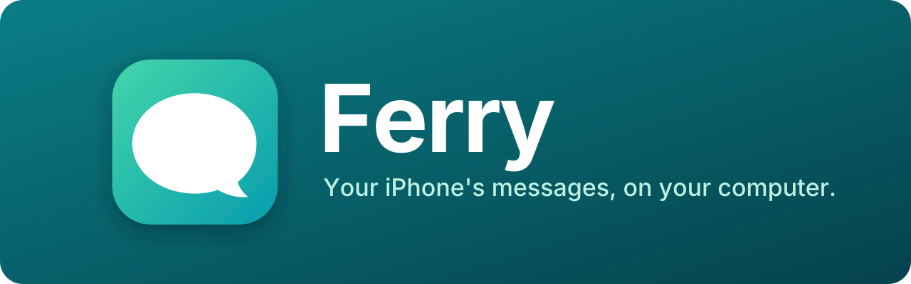
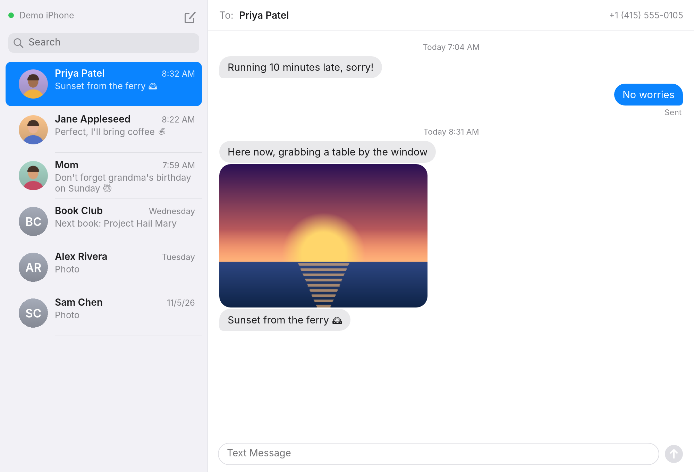
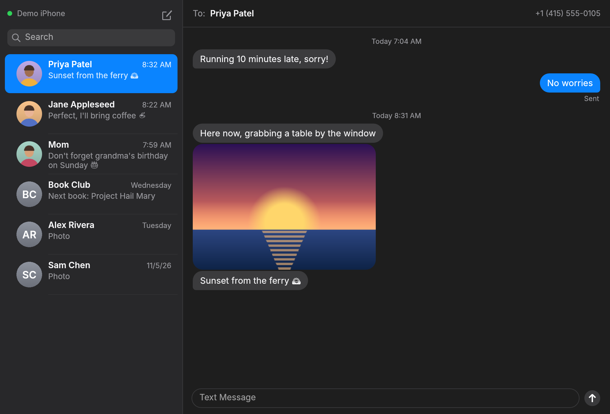
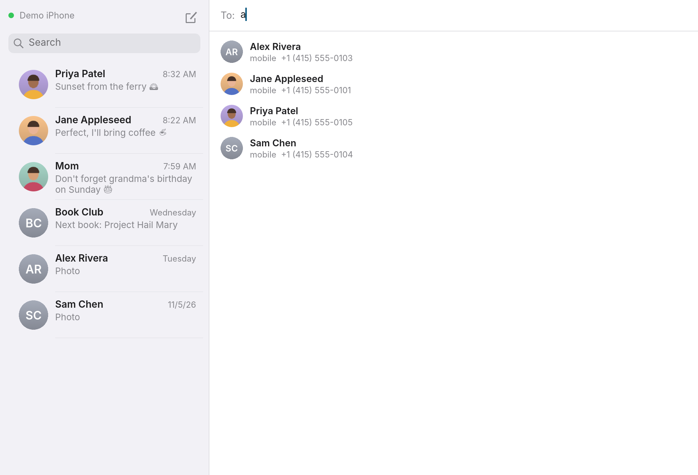

<p align="center">
  
</p>

<p align="center">
  <a href="https://github.com/ianmarmour/Ferry/actions/workflows/ci.yml"></a>
  <a href="LICENSE"></a>
  
  <a href="#platforms"></a>
</p>

**Text from your computer through your iPhone, with nothing to install on the phone.**

Ferry brings your iPhone's messages to your Linux, Windows or Mac desktop
over Bluetooth. Read your conversations, reply, and start new ones with anyone
in your contacts, in a window styled after Messages on the Mac. It talks to the
phone the way a car does, so there's no app to install on the iPhone, no Mac to
relay through and no cloud service in between.

<p align="center">
  
</p>

## Highlights

- **Nothing on the Phone** - Ferry uses the Bluetooth profiles car kits use:
  the Message Access Profile for messages and the Phone Book Access Profile
  for contacts. Pair once, turn on two switches on the iPhone, and you're set.
- **Feels Like Messages** - Conversations with contact photos, bubbles grouped
  by time, delivery status, photos inline, and light and dark modes.
- **Stays Out of the Way** - New messages raise desktop notifications, and
  closing the window keeps Ferry connected in the system tray.
- **Private** - Messages travel over a direct, encrypted Bluetooth link between
  your phone and your computer, and are kept only on your computer.
- **Multi Platform** - One app for Linux, Windows and macOS, built on the
  [`obex-protocol`](https://crates.io/crates/obex-protocol) and
  [`obex-protocol-map`](https://crates.io/crates/obex-protocol-map) crates.

## Platforms

| Platform | Download |
|---|---|
| Linux (x86_64) | [TARBALL](https://github.com/ianmarmour/Ferry/releases/latest/download/ferry-linux-x86_64.tar.gz) |
| Windows (x64) | [ZIP](https://github.com/ianmarmour/Ferry/releases/latest/download/ferry-windows-x64.zip) |
| macOS (Apple silicon) | [APP](https://github.com/ianmarmour/Ferry/releases/latest/download/ferry-macos-app.zip) |

Every download is on the
[latest release](https://github.com/ianmarmour/Ferry/releases/latest), and
the [setup guide](docs/setup.md) walks through pairing your iPhone and running
Ferry on each platform. To look around without a phone, run
`ferry --demo`, which connects to a simulated iPhone.

<p align="center">
  
  
</p>

## Documentation

- **[Setup](docs/setup.md)**: pair your iPhone, install Ferry, and what to
  know on each platform.
- **[Troubleshooting](docs/troubleshooting.md)**: fixes for common problems,
  how to collect logs, and known limitations.
- **[How It Works](docs/architecture.md)**: how Ferry talks to the phone,
  and how the code fits together.
- **[Releasing](docs/releasing.md)**: how a release is built and published.

## Repository layout

| Path | What it is |
|---|---|
| [`src/bluetooth`](src/bluetooth) | The Bluetooth backends: BlueZ on Linux, WinRT on Windows, IOBluetooth on macOS, and the simulated iPhone |
| [`src/session.rs`](src/session.rs) | The worker that talks to the phone over MAP and PBAP |
| [`src/model.rs`](src/model.rs), [`src/contacts.rs`](src/contacts.rs), [`src/text.rs`](src/text.rs) | Messages, conversations, contacts and their cache |
| [`src/pbap.rs`](src/pbap.rs) | A Phone Book Access client on `obex-protocol` |
| [`src/ui`](src/ui), [`src/notify.rs`](src/notify.rs) | The window, tray icon and desktop notifications |
| [`tests`](tests) | End-to-end tests against the simulated iPhone, BlueZ and the tray |
| [`assets`](assets) | The icon, the banner and their renderings |
| [`macos`](macos) | The macOS app bundle |
| [`docs`](docs) | User and developer guides |

## Contributing

Bug reports and pull requests are welcome. To build Ferry yourself, install
Rust 1.95 or newer and run:

```bash
cargo run --release
```

`cargo run --release -- --demo` runs it against the simulated iPhone, and
`cargo test` runs the tests, including end-to-end sessions with the simulated
iPhone. CI checks formatting, Clippy and the tests on Linux, Windows and macOS.

## License

Ferry is licensed under the [MIT License](LICENSE).
